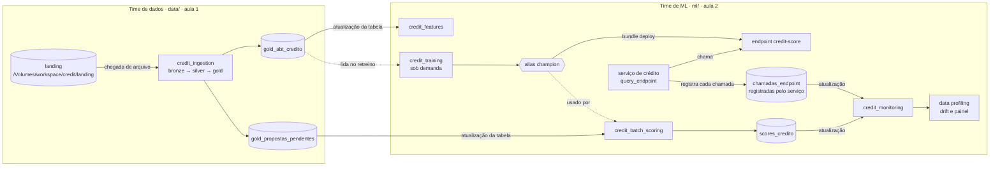
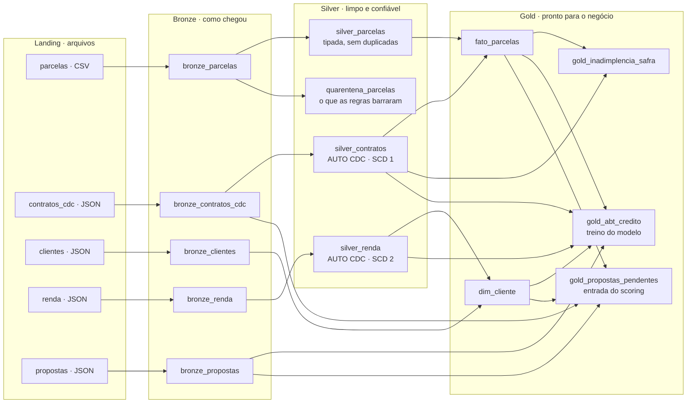
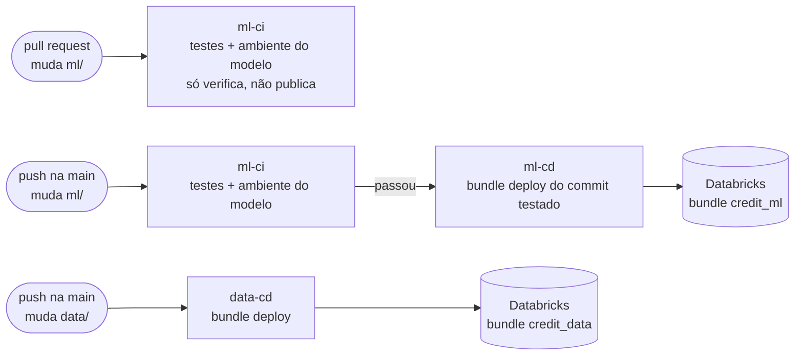

# Credit Score · do arquivo bruto ao modelo servido e monitorado

Projeto fim a fim de score de inadimplência no Databricks, usado em duas aulas.

## Contexto

Uma financeira concede crédito pessoal, cartão e consignado. Cada proposta passa por uma analista,
que precisa decidir em segundos: aprovar, recusar ou mandar para análise manual. A pergunta por trás
da decisão é sempre a mesma: **qual a chance de este cliente atrasar 90 dias ou mais?**

Hoje essa resposta depende de dados espalhados por cinco sistemas que não conversam entre si:

| Sistema | O que entrega | O problema |
| --- | --- | --- |
| Core bancário | parcelas pagas e em aberto | exporta valor como `R$ 1.290,00` ou `1290.00`, datas em dois formatos, linhas repetidas, CPF aberto |
| Gestão de contratos | eventos de cada contrato (CDC) | eventos chegam fora de ordem; um atraso pode chegar meses depois de uma renegociação |
| Cadastro | dados do cliente | segmento e canal |
| Renda | renda declarada | muda com o tempo; o modelo precisa da renda **da época** de cada contrato |
| Originação | o que se sabia no pedido | uso do limite, consultas ao bureau, pedidos recentes; e as propostas novas, ainda sem contrato |

O projeto resolve isso em duas etapas, uma por aula:

- **Aula 1 · Engenharia de dados — "dá para confiar no dado?"** Os arquivos desses sistemas viram,
  no lakehouse, uma base confiável: limpa, tipada, sem duplicadas, com o histórico certo e uma linha
  por contrato com o que se sabia na concessão e o que aconteceu depois (a ABT). O fio condutor é
  acompanhar **um contrato** da landing até a gold.
- **Aula 2 · MLOps — "dá para confiar no modelo, hoje e amanhã?"** A ABT treina um score que devolve
  probabilidade, faixa de risco (A a E) e motivos. Ele é validado antes de ir ao ar, servido para a
  tela da analista (endpoint) e para a cobrança (batch), recusa dado fora do contrato e é monitorado,
  porque em crédito o rótulo só chega meses depois e o primeiro sinal de problema é o drift.

Como numa empresa de verdade, são **dois times com dois projetos independentes**: o time de dados
(`data/`) é dono da landing até a gold e publica as tabelas gold como produto; o time de ML (`ml/`)
consome essas tabelas pelo Unity Catalog, sem saber como foram construídas. Cada projeto tem seu
bundle, seu CI/CD e seu ritmo de deploy, e um não chama o outro: o elo são os dados. Tudo roda no
Databricks Free Edition, com dados sintéticos gerados para ter os problemas acima de propósito.

O contexto de negócio completo (o ciclo do crédito, cada fonte de origem, a definição do alvo e das
variáveis, como ler score, faixas e motivos, e o que o monitoramento deve mostrar) está em
[docs/contexto-de-negocio.md](docs/contexto-de-negocio.md).

## Estrutura

```
credit-score-mlops/
├── README.md                           # este guia
├── docs/contexto-de-negocio.md         # o problema de crédito, as fontes, o alvo e as variáveis
├── data/                               # TIME DE DADOS · aula 1
│   ├── databricks.yml                  #   bundle credit_data
│   ├── resources/
│   │   ├── foundation.yml              #     schema credit, volume landing, anomaly detection
│   │   └── ingestion.yml               #     pipeline Lakeflow + job que dispara com a chegada de arquivos
│   ├── src/ingestion/credit_pipeline.sql   # landing → bronze → silver → gold
│   └── notebooks/
│       ├── simulate_source_systems.py  #     arquivos dos sistemas de origem na landing
│       └── follow_a_contract.py        #     um contrato da landing até a gold
├── ml/                                 # TIME DE ML · aula 2
│   ├── databricks.yml                  #   bundle credit_ml: wheel do pacote, ambiente dos jobs
│   ├── pyproject.toml                  #   o pacote credit_score
│   ├── resources/
│   │   ├── foundation.yml              #     schema credit_ml, experimento, modelo, anomaly detection
│   │   ├── features.yml                #     job que dispara quando a ABT muda (features_cliente)
│   │   ├── training.yml                #     job de treino, sob demanda
│   │   ├── deployment.yml              #     deployment job: avaliação, aprovação na UI e deploy
│   │   ├── scoring.yml                 #     job que dispara quando chegam propostas novas
│   │   ├── monitoring.py               #     job que dispara quando o modelo pontua (criado quando as tabelas existem)
│   │   ├── serving.py                  #     endpoint credit-score com a versão do alias champion
│   │   ├── inference_profile.py        #     data profiling da tabela de inferência
│   │   ├── model_alerts.py             #     SQL alerts de drift e de entrada fora do contrato
│   │   ├── notifications.py            #     lê os destinatários do secret scope; e-mail de falha nos jobs
│   │   ├── alerts/                     #     as consultas dos alertas (.sql)
│   │   └── dashboard.yml               #     dashboard do modelo (dashboards/monitoramento.lvdash.json)
│   ├── src/                            #   scripts dos jobs (spark_python_task) e o pacote
│   │   ├── credit_score/               #     pacote de produção (wheel nos jobs; dentro do modelo registrado)
│   │   ├── features/build_features.py  #     gold → features_cliente
│   │   ├── training/train_register.py
│   │   ├── scoring/batch_scoring.py
│   │   └── monitoring/                 #     build_inference_log.py, monitor_model.py
│   ├── dashboards/                     #   monitoramento.lvdash.json: o dashboard do modelo, em português
│   ├── scripts/connect_deployment_job.py #   liga o deployment job ao modelo (roda no ml-cd)
│   ├── notebooks/                      #   query_endpoint, explore_scores
│   │   └── deployment/                 #     evaluation, approval, deploy (tarefas do deployment job)
│   └── tests/
└── .github/workflows/                  # data-cd.yml · ml-ci.yml · ml-cd.yml
```

## Como os dois times se conectam

Nenhum job chama outro. Cada etapa dispara quando o dado de que ela depende muda:



A interface entre os times são as tabelas `workspace.credit.gold_abt_credito` e
`workspace.credit.gold_propostas_pendentes`. O monitoramento usa o Data Quality Monitoring do Databricks em
dois níveis:

| Recurso | Onde | Pergunta | Time |
| --- | --- | --- | --- |
| Anomaly detection | schemas `workspace.credit` e `workspace.credit_ml` | cada tabela está em dia (freshness) e completa (completeness)? | os dois |
| Data profiling (perfil de inferência) | `workspace.credit_ml.credit_score_inference_log` | as entradas e o score mudaram em relação à validação do treino? | ML |

## Preparação (antes das duas aulas)

Com o repositório num Git folder do Databricks e o Databricks CLI autenticado, uma vez:

```bash
cd data && databricks bundle deploy && cd ..
#   rode o notebook data/notebooks/simulate_source_systems.py no workspace: ele grava os arquivos na
#   landing, e a chegada deles dispara a ingestão; espere o pipeline terminar

cd ml && uv sync                              # cria ml/.venv com o pacote, os testes e o que o bundle importa
#   antes do primeiro deploy, crie o secret scope credit_ml com quem recebe os avisos (ver "Alertas")
databricks bundle deploy                       # sem champion: avisa e pula endpoint, monitoramento e perfil
databricks bundle run features                 # features_cliente; depois, cada atualização da ABT a refaz
uv run python scripts/connect_deployment_job.py   # liga o deployment job ao modelo (o ml-cd também faz)
databricks bundle run training                 # registra a v1 como challenger e grava a baseline
#   o deployment job dispara sozinho e para na aprovação: aprove a v1 na página da versão
#   (Unity Catalog › credit_score › versão 1 › Approve); o deploy move o champion
databricks bundle deploy                       # publica o endpoint
databricks bundle run batch_scoring            # scores_credito
#   rode notebooks/query_endpoint.py: o serviço chama o endpoint e grava chamadas_endpoint
databricks bundle deploy                       # cria o job de monitoramento (as duas tabelas do gatilho existem)
databricks bundle run monitoring --only build_inference_log
databricks bundle deploy                       # cria o perfil de inferência
#   pelo GitHub, os deploys são o ml-cd: rode-o manualmente (Actions › ml-cd › Run workflow) entre as etapas
```

Daqui em diante, dispara sozinho: arquivos novos na landing → ingestão → features e scoring →
monitoramento. O treino é sob demanda, e cada versão nova dispara o deployment job, que espera a
aprovação na UI.

---

## Aula 1 · Engenharia de dados: do arquivo bruto à ABT (`data/`)

**Objetivo**: acompanhar um dado da landing até a gold e entender o que cada camada faz com ele.

### Roteiro

1. **Os dados que chegam** (`notebooks/simulate_source_systems.py`): cinco sistemas deixam arquivos
   na landing (`/Volumes/workspace/credit/landing`), com problemas de propósito.
2. **O pipeline** (`src/ingestion/credit_pipeline.sql`): lido de cima para baixo, bronze → silver →
   gold. A chegada dos arquivos dispara o job `credit_ingestion`; acompanhe o grafo na UI do pipeline.
3. **Um contrato, camada por camada** (`notebooks/follow_a_contract.py`): o notebook escolhe o contrato
   que mais mostra (ou o que você digitar no widget) e o acompanha da landing à ABT.
4. **Linhagem**: **Catalog** › `workspace.credit.gold_abt_credito` › **Lineage**.
5. **A gold como produto**: **Catalog** › schema `workspace.credit` › aba **Quality**: o anomaly detection
   acompanha se cada tabela está em dia e completa.

### O caminho das tabelas

O grafo que o pipeline desenha na UI, e que o notebook percorre com um contrato:



### O que o contrato mostra em cada camada

| Camada | Tabela | Conceito |
| --- | --- | --- |
| Landing | `parcelas` (CSV), `contratos_cdc`, `clientes`, `renda`, `propostas` (JSON) | Dado sujo: `R$ 1.290,00` e `1290.00`, datas em dois formatos, parcela repetida, CPF aberto, eventos fora de ordem |
| Bronze | `bronze_*` | Guardar como chegou; Auto Loader lê cada arquivo uma vez; colunas de rastreio (`_arquivo`, `_carga_em`) |
| Silver | `silver_parcelas` | Tipar, CPF vira hash (LGPD), tirar duplicadas; expectations com `DROP ROW` |
| Silver | `quarentena_parcelas` | O que as regras barraram, com o motivo |
| Silver | `silver_contratos` | `AUTO CDC` (SCD 1): estado atual pela ordem do fato, com delete |
| Silver | `silver_renda` | `AUTO CDC` (SCD 2): a renda que valia em cada período |
| Gold | `dim_cliente`, `fato_parcelas` | Esquema estrela: o fato só com chaves e medidas |
| Gold | `gold_inadimplencia_safra` | Indicador de negócio por safra |
| Gold | `gold_abt_credito` | A ABT point-in-time que treina o modelo, com `EXPECT ... FAIL UPDATE` |
| Gold | `gold_propostas_pendentes` | Propostas novas, ainda sem contrato, com as mesmas features: a entrada do scoring |

### Números de referência

~54 mil parcelas na landing, 536 duplicadas e 20 sem contrato (que vão para a quarentena); ~3,7 mil
contratos na ABT, com ~15% de inadimplência; 5 mil propostas pendentes. Com os dados simulados, o
contrato escolhido é o 3532: evento de CDC fora de ordem, parcela duplicada, valor em formato
brasileiro e renda revista depois da concessão.


---

## Aula 2 · MLOps: do modelo treinado ao modelo monitorado (`ml/`)

**Objetivo**: levar a ABT a um score em produção, com o mesmo código e o mesmo contrato de entrada
em todos os caminhos, sem depender do ciclo do time de dados.

### Roteiro

1. **Features e treino**:
   - `src/features/build_features.py` (job `credit_features`, disparado quando a ABT muda): a
     fotografia mais recente de cada cliente (`features_cliente`), o histórico que o serviço de
     crédito junta à proposta.
   - `src/training/train_register.py` (job `credit_training`, **sob demanda**): retreinar é uma
     decisão, tomada a partir do monitoramento (drift, entrada fora do contrato) ou de uma mudança de
     política ou de público, e não de cada atualização da ABT, que quase nunca traz contratos novos com
     o alvo já observado. Contrato de entrada na ABT, nested runs, escolha pela log
     loss, validação por segmento, portão de AUC, **validação pré-deploy** do pacote, registro com
     **express deployment** e alias `challenger`.
2. **Deploy** (`bundle deploy`, feito pelo CD): `resources/serving.py` lê o alias `champion` e
   publica o endpoint `credit-score`.
3. **Scoring batch** (job `credit_batch_scoring`, disparado quando chegam propostas novas): as
   propostas passam pelo contrato em SQL; as que falham vão para a quarentena com o motivo, e o resto
   é pontuado pelo `champion`.
4. **Consumir o modelo** (`notebooks/query_endpoint.py`): o serviço de crédito monta a requisição
   (histórico + proposta + eventos recentes), o endpoint responde score, faixa e motivos e recusa o
   que está fora do contrato (HTTP 400); latência p50/p95. O serviço registra cada chamada (entradas,
   score, status, latência e versão servida) em `chamadas_endpoint`, com `credit_score.service.call_record`.

   > **Inference tables.** O Model Serving pode registrar sozinho cada requisição e resposta numa
   > tabela Delta (inference table do AI Gateway, `ai_gateway.inference_table_config` no endpoint). Isso
   > simplifica o processo: o registro vale para qualquer cliente, sem código no serviço, e não depende de
   > cada cliente lembrar de gravar. O recurso não está disponível no Databricks Free Edition
   > (`FEATURE_DISABLED`), por isso aqui o próprio serviço grava as chamadas. Num workspace pago, basta
   > ligar a inference table em `resources/serving.py` e trocar a fonte do endpoint em
   > `build_inference_log.py`.
5. **Monitoramento** (job `credit_monitoring`, disparado quando o modelo pontua):
   - `src/monitoring/build_inference_log.py`: junta as chamadas aceitas pelo endpoint
     (`chamadas_endpoint`, já com a versão do modelo) e o scoring batch em `credit_score_inference_log`.
   - **Data profiling** (`resources/inference_profile.py`): perfil de inferência sobre essa tabela,
     com a baseline gravada pelo treino; calcula PSI, KS e qui-quadrado por coluna, por dia, versão
     do modelo e segmento, e gera um painel padrão (em inglês). Nele, os filtros padrão escondem a
     janela do dia até ela fechar e procuram o modelo `*`: para ver os dados do dia, ponha *Time Window
     End* no futuro e escolha a versão em *Model Id*.
   - **Dashboard do modelo** (`resources/dashboard.yml`, *Dashboards* › `credit_score · monitoramento do
     modelo`), em português: versão em produção, maior PSI e quantas colunas passaram de 0,2, a tabela
     de PSI por coluna e segmento, o PSI ao longo do tempo, as faixas A–E no treino e em produção, as
     chamadas, a latência e a quarentena por regra. Usa a janela mais recente, mesmo aberta.
   - `src/monitoring/monitor_model.py`: pede o refresh do perfil e espera terminar.
   - **SQL alerts** (`resources/model_alerts.py`), como a documentação do data profiling recomenda:
     consultas sobre as tabelas de métricas, avaliadas todo dia às 8h, que avisam por e-mail. Ver
     [Alertas](#alertas).
   - `notebooks/explore_scores.py`: scores, quarentena, chamadas e drift.
6. **Promoção** (deployment job `credit_deployment`, disparado por cada versão nova): avalia a versão
   nova e o champion na mesma janela, para na aprovação até alguém aprovar na UI e então move o
   `champion` e atualiza a versão servida no endpoint. Ver a [definição do champion](#definição-do-champion).

### Definição do champion

O treino é sob demanda e cada execução registra um `challenger`; ele só vira `champion` por aprovação
explícita na UI. Ninguém executa a promoção com o próprio usuário: quem executa é o deployment job
`credit_deployment` (MLflow 3), ligado ao modelo no Unity Catalog, que roda sozinho a cada versão nova:

| Tarefa | O que faz |
| --- | --- |
| `evaluation` | pontua a versão nova **e o champion na mesma janela** (a validação mais recente da ABT atual), pelo PyFunc registrado; tudo na run de treino da versão (métricas `deploy_*`, também na página da versão) |
| `approval` | falha até a versão ter a tag `approval=Approved`; o botão *Approve* grava a tag e retoma o job daqui |
| `deployment` | move o `champion`, remove o `challenger` e troca a versão servida no endpoint |

**Quando retreinar**: alerta do monitoramento (drift do score ou das entradas, taxa fora do contrato),
mudança de política de crédito, de produto ou de público, ou safras novas com o alvo já observado.

**O que cada treino deixa na run do candidato escolhido** (experimento `credit_score`, run filha
apontada pela versão no Unity Catalog):

| Onde | O quê |
| --- | --- |
| Métricas (`mlflow.models.evaluate`) | `log_loss`, `roc_auc`, `precision_recall_auc` e as de corte em 0,5 |
| Métricas (nossas) | `ks`, `gini` |
| `calibration_curve_plot.png` | probabilidade prevista × inadimplência observada |
| `lift_curve_plot.png` | quanto risco se concentra no topo do score |
| `roc_curve_plot.png`, `precision_recall_curve_plot.png` | ordenação do score |
| `faixas.json` | volume, score médio e inadimplência observada por faixa A–E |
| `metrics_by_segment.json` | as métricas por segmento |
| `estimator` | o classificador do candidato (formato `mlflow.sklearn`, usado pela avaliação) |

As métricas de corte em 0,5 (`accuracy_score`, `precision_score`, `recall_score`, `f1_score` e a matriz
de confusão) não dizem nada aqui: a decisão é por faixa, e a inadimplência fica perto de 10%. A
calibração do MLflow usa intervalos de largura fixa; acima de 0,3 há pouca gente em cada ponto, e a
`faixas.json` complementa com a taxa observada por faixa.

**Como comparar** (tudo na UI):

1. Na página da versão (Unity Catalog › `credit_score` › versão): o painel do deployment job mostra em
   que tarefa ele está, e as métricas `deploy_*` da avaliação.
2. Na run de treino da versão (link na página da versão): as métricas `deploy_nova_*` e
   `deploy_champion_*` lado a lado, na mesma janela, e as tabelas em `deploy/nova/` e
   `deploy/champion/` (`faixas.json`, `metrics_by_segment.json`).
3. Para as curvas (calibração, lift, ROC), selecione no experimento as runs de treino das duas versões e
   use *Compare*. Essas são da validação de cada treino, em janelas diferentes: servem para tendência.

**Critérios** (sobre as métricas `deploy_*`, salvo as curvas):

1. **Calibração**: a curva segue a diagonal onde está o volume (scores baixos), e na `faixas.json` a
   inadimplência observada de cada faixa cai dentro do intervalo dela e sobe de A para E. O score é usado como probabilidade: é o critério principal.
2. **Log loss** não maior que a do `champion`; **`roc_auc`** e **KS** sem queda relevante
   (referência: 0,01 de AUC).
3. **Lift**: o topo do score concentra pelo menos o mesmo risco.
4. **Segmentos**: nenhum segmento piora de forma relevante, mesmo que o global melhore.
5. **Distribuição por faixa**: mudanças grandes na participação de cada faixa mudam a aprovação; o
   negócio precisa concordar antes.

**Decisão**:

- **Aprovar**: escreva na descrição da versão o motivo (o que pesou nos critérios) e clique em
  *Approve* no painel do deployment job. O job retoma da aprovação e faz o deploy. A tag e o histórico
  do job registram quem aprovou e quando.
- **Rejeitar**: escreva o motivo na descrição, remova o alias `challenger` e cancele a execução do
  job. A versão fica registrada como histórico, e nada muda em produção.

**Quem pode o quê** (em produção):

| Quem | Permissão |
| --- | --- |
| Service principal de ML | dono do modelo, dos jobs e do endpoint; o deployment job roda como ele (`run_as`) |
| Aprovadores | `APPLY TAG` no modelo e `CAN MANAGE RUN` no `credit_deployment`; com governed tags, só eles aplicam a tag `approval` |
| Time de modelagem | leitura no experimento e no modelo, `CAN MANAGE RUN` no `credit_training` |

O job dispara com a credencial do dono do modelo, e quem cria versões no modelo executa código nele:
`CREATE MODEL VERSION` fica só com o service principal.

### Como o código chega aos jobs

Nenhum script manipula `sys.path` nem instala pacote. O `credit_score` é um pacote de verdade
(`pyproject.toml`), e o bundle cuida do resto:

1. `artifacts` constrói a wheel no `bundle deploy` (`uv build --wheel`, com versão dinâmica a cada deploy).
2. A variável `job_environment` (em `databricks.yml`) define o ambiente serverless dos jobs: a wheel e as
   versões fixas do `mlflow` e do SDK. Cada job a referencia com `${var.job_environment}`.
3. O bundle troca `./dist/*.whl` pelo caminho absoluto da wheel no workspace, e os caminhos dos scripts
   pelo caminho absoluto dos arquivos publicados.

As etapas de `src/` são scripts (`spark_python_task`) porque, no serverless, só tarefas de script aceitam
um ambiente declarado no job; tarefas de notebook exigiriam `%pip` dentro do código. No treino, o pacote
vai para dentro do modelo registrado a partir de onde ele está instalado (`credit_score.__file__`).

### O contrato de entrada em todos os caminhos

As regras de domínio ficam num lugar só, `src/credit_score/contract.py`:

| Onde | Como | Fora do contrato |
| --- | --- | --- |
| Treino | `validate_inputs` | a linha sai; acima de 1%, o treino para |
| Antes do registro | `validate_serving_input` com um caso válido e um fora | a versão não é registrada |
| Scoring batch | `contract_sql_rules()` | a linha vai para `propostas_quarentena`; acima de 5%, o job para |
| Endpoint | assinatura MLflow (colunas e tipos) + contrato no `predict` | HTTP 400 com a regra quebrada |
| Monitoramento | `chamadas_endpoint` (`status_code`) e quarentena | alerta acima de 2% |


### Números de referência

AUC ~0,78 na ABT; 1,5% das propostas pendentes em quarentena (75 de 5 mil); drift esperado nas
propostas pendentes (uso médio do limite de ~0,48 para ~0,72), que o PSI do data profiling deve acusar.

---

## CI/CD, um por time



| Workflow | Quando | O que faz |
| --- | --- | --- |
| `data-cd.yml` | push na `main` que muda `data/` | `bundle deploy` do projeto de dados |
| `ml-ci.yml` | pull request ou push na `main` que muda `ml/` | testes do pacote e o pacote do modelo num ambiente recriado do zero; não publica nada |
| `ml-cd.yml` | quando o `ml-ci` passa num push na `main` | `bundle deploy` do projeto de ML, do mesmo commit que foi testado |

Uma mudança no pipeline não reimplanta o modelo, e vice-versa. Os deploys autenticam como o service
principal `esteira-ci-cd` (OAuth M2M), com os secrets `DATABRICKS_HOST`, `DATABRICKS_CLIENT_ID` e
`DATABRICKS_CLIENT_SECRET` do environment `databricks` do GitHub, onde dá para exigir aprovação antes do
deploy. Os jobs, o modelo e o endpoint pertencem ao service principal e rodam como ele. Ele precisa de
`USE CATALOG` e `CREATE SCHEMA` no catálogo, `CAN_USE` no SQL warehouse e `READ` no secret scope `credit_ml`. Quem recebe os avisos não passa pelo GitHub: fica em secrets do Databricks
(ver [Alertas](#alertas)).

### Alertas

Quem recebe fica fora do repositório (que é público), no secret scope `credit_ml` do Databricks. O deploy
lê os secrets pelos resources em Python (`resources/notifications.py`). Quem faz o deploy precisa de READ
no scope.

| Secret (`credit_ml/…`) | Para quê |
| --- | --- |
| `alert_email` | falha dos jobs de ML e falha do refresh do perfil de inferência |
| `alert_destination_id` | notification destination (e-mail) dos SQL alerts |

Para configurar (uma vez; o notification destination precisa de admin do workspace):

```bash
databricks secrets create-scope credit_ml
databricks secrets put-secret credit_ml alert_email --string-value voce@empresa.com
databricks notification-destinations create --json \
  '{"display_name": "credit_ml · alertas do modelo", "config": {"email": {"addresses": ["voce@empresa.com"]}}}'
databricks secrets put-secret credit_ml alert_destination_id --string-value <id devolvido acima>
```

| Aviso | Fonte | Por onde | Quando |
| --- | --- | --- | --- |
| `credit_score · drift acima de 0,2 (PSI)` | `credit_score_inference_log_drift_metrics`, janela mais recente, contra a baseline | SQL alert (e-mail), todo dia às 8h | o maior PSI (qualquer coluna ou segmento) passa de 0,2 |
| `credit_score · entrada fora do contrato acima de 2%` | `chamadas_endpoint` (7 dias) e o último lote da `propostas_quarentena` | idem | a maior das duas taxas passa de 2% |
| falha de job | `credit_training`, `credit_features`, `credit_batch_scoring`, `credit_monitoring` | e-mail | o job falha |
| falha do perfil | perfil de inferência | e-mail | o refresh falha |

O e-mail dos SQL alerts usa um template próprio (`custom_summary` e `custom_description` em
`resources/model_alerts.py`): assunto `[credit_score] <alerta>: <estado>`, o valor contra o limite e a
tabela do resultado da consulta (no drift, onde está o maior PSI e quantas colunas passaram do limite).
As consultas ficam em `resources/alerts/` e os limites em `resources/model_alerts.py`.

Ficam sem aviso por e-mail:

- **o anomaly detection do schema** (tabela desatualizada ou incompleta): ele não aceita destino de
  e-mail, só integrações (Slack, Microsoft Teams, webhook e afins) ou usuários do workspace. Os
  resultados ficam na aba *Quality* do schema; com uma integração, basta apontar
  `anomaly_detection_config.notification_settings.on_unhealthy_table` em `resources/foundation.yml`.
- **o `credit_deployment`**: a tarefa de aprovação falha de propósito até a aprovação.

As dependências do `ml/` ficam no `pyproject.toml` e no `uv.lock`, em dependency groups: `dev` (testes, nas versões
do ambiente de treino e do endpoint) e `bundle` (o que o código Python do bundle importa). Localmente, em `ml/`:
`uv sync && uv run pytest -q`. O teste do ambiente isolado roda à parte: `uv run pytest -m environment -o addopts=""`.
O ambiente do modelo registrado não usa o `uv.lock`: vem só do `pip_requirements` (`MLFLOW_UV_AUTO_DETECT=false`
no treino), com as versões exatas e o `mlflow` completo que o endpoint precisa.

---

## Convenções

Código (pastas, scripts, funções, variáveis) em inglês; docstrings no padrão Google, em português.
Formatação e lint com o ruff (`ruff.toml` na raiz): em `ml/`, `uv run ruff format . && uv run ruff check .`;
o `ml-ci` e o `data-cd` falham se o código não estiver formatado ou tiver aviso.
Dados (tabelas e colunas) em português, como chegam dos sistemas de origem. O catálogo é a variável
`catalog` dos dois bundles (padrão `workspace`, o catálogo do Databricks Free Edition), repassada aos jobs
como `--catalog` e aos notebooks como widget: schema `credit` do time de dados e `credit_ml` do time de ML.
Os nomes de tabela neste guia usam o padrão; para outro catálogo, `databricks bundle deploy --var catalog=<nome>`. Os dois bundles usam o motor de deploy `direct`,
tudo serverless, nomes fixos e um alvo `dev`.
