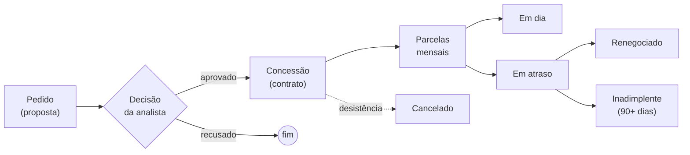

# Contexto de negócio · score de inadimplência

Este documento explica o **porquê** do projeto: o problema de crédito que ele resolve, de onde vêm os
dados, como o alvo e as variáveis foram definidos e como ler o que o modelo devolve. O **como** (pipeline,
jobs, deploy, monitoramento) está no [README](../README.md).

Os dados são sintéticos, gerados por `data/notebooks/simulate_source_systems.py`, mas imitam uma
financeira real. Onde o documento descreve uma regra, ela é a que está implementada; onde é só um
exemplo de política de crédito, isso está dito.

## Sumário

1. [O problema](#1-o-problema)
2. [O ciclo de vida de um crédito](#2-o-ciclo-de-vida-de-um-crédito)
3. [Produtos, segmentos e canais](#3-produtos-segmentos-e-canais)
4. [Fontes de origem](#4-fontes-de-origem)
5. [Do dado bruto à ABT: as decisões de modelagem](#5-do-dado-bruto-à-abt-as-decisões-de-modelagem)
6. [O alvo: inadimplente em 90 dias](#6-o-alvo-inadimplente-em-90-dias)
7. [As variáveis do modelo](#7-as-variáveis-do-modelo)
8. [O que o modelo devolve](#8-o-que-o-modelo-devolve)
9. [Onde o score é usado](#9-onde-o-score-é-usado)
10. [Por que monitorar, e o que esperar](#10-por-que-monitorar-e-o-que-esperar)
11. [Os dados sintéticos](#11-os-dados-sintéticos)
12. [Limites e decisões em aberto](#12-limites-e-decisões-em-aberto)
13. [Glossário](#13-glossário)

---

## 1. O problema

Uma financeira concede **crédito pessoal**, **cartão** e **consignado**. Cada pedido chega a uma
analista, que tem segundos para decidir entre aprovar, recusar ou mandar para análise manual.

Os dois erros possíveis custam caro, e de formas diferentes:

| Erro | O que acontece | Custo |
| --- | --- | --- |
| Aprovar quem não vai pagar | o contrato vira inadimplência | perda do valor emprestado, custo de cobrança, provisão |
| Recusar quem pagaria | o cliente vai para a concorrência | receita perdida e cliente insatisfeito |

O score não decide sozinho. Ele dá à analista e às áreas de política de crédito uma **probabilidade de
inadimplência** comparável entre propostas, uma **faixa de risco** para aplicar a política e os
**motivos** que pesaram, para a decisão poder ser explicada.

A pergunta que o modelo responde é sempre a mesma: **qual a chance de este contrato atrasar 90 dias ou
mais em alguma das 6 primeiras parcelas?**

## 2. O ciclo de vida de um crédito

- **Pedido (proposta)**: o cliente pede um valor e um prazo. Nesse momento a financeira sabe a renda
  declarada, o histórico do cliente e os dados da originação (uso do limite, consultas ao bureau,
  pedidos recentes).
- **Concessão**: aprovado, o pedido vira um contrato, com data de concessão, produto, valor e prazo.
  O mês da concessão é a **safra** do contrato.
- **Parcelas**: uma por mês, com vencimento e, quando paga, a data do pagamento.
- **Atraso**: parcela paga depois do vencimento, ou não paga até a data de corte. Atraso de 90 dias ou
  mais é o marco de inadimplência usado aqui (e comum no mercado).
- **Renegociação**: um contrato em atraso pode ser renegociado. Isso **não apaga** o atraso que já
  aconteceu: o alvo olha as parcelas, não o status final.
- **Cancelamento**: desistência logo após a concessão. O contrato some da base (evento `DELETE`).

## 3. Produtos, segmentos e canais

Cada cliente tem um **segmento**, e o segmento define o produto:

| Segmento | Produto | Perfil de risco | Por quê |
| --- | --- | --- | --- |
| `varejo` | crédito pessoal | maior | renda menor, sem garantia, mais uso do limite e mais consultas |
| `alta_renda` | cartão | intermediário | renda alta, mas crédito rotativo |
| `consignado` | consignado | menor | a parcela é descontada direto da folha de pagamento |

Distribuição simulada: 60% varejo, 15% alta renda, 25% consignado.

O **canal** (`app`, `agencia`, `correspondente`) chega na ABT, mas não entra no modelo: é contexto
para análises, não um fator de risco que se queira usar.

## 4. Fontes de origem

Cinco sistemas, que não conversam entre si, deixam arquivos na área de pouso
(`/Volumes/workspace/credit/landing`). Os problemas de cada um são de propósito: são os que o pipeline
precisa resolver.

### 4.1 Core bancário · parcelas

| | |
| --- | --- |
| Formato | CSV, tudo como texto |
| Grão | uma linha por parcela de cada contrato |
| Campos | `parcela_id`, `contrato_id`, `numero`, `vencimento`, `valor`, `pago_em`, `cpf` |
| Problemas | metade dos valores em formato brasileiro (`R$ 1.290,00`) e metade em `1290.00`; vencimento em `dd/MM/yyyy` ou `yyyy-MM-dd`; ~1% de linhas repetidas; 20 parcelas sem contrato; **CPF aberto** |
| Tratamento | tipagem, data única, CPF vira hash SHA-256 (LGPD), duplicadas saem, parcela sem contrato vai para a quarentena com o motivo |

É daqui que sai o **atraso**: a diferença entre `pago_em` (ou a data de corte, se não foi paga) e o
`vencimento`.

### 4.2 Gestão de contratos · eventos (CDC)

| | |
| --- | --- |
| Formato | JSON, um evento por mudança |
| Grão | um evento por contrato e mudança de status |
| Campos | `contrato_id`, `cliente_id`, `produto`, `valor`, `prazo_meses`, `data_concessao`, `status`, `operacao` (`INSERT`/`UPDATE`/`DELETE`), `evento_em` (quando aconteceu), `recebido_em` (quando chegou) |
| Eventos | `em_dia` na concessão; `em_atraso` entre 60 e 200 dias depois; `renegociado` (30% dos atrasados) entre 220 e 300 dias depois; `cancelado` (15 contratos, `DELETE`) dois dias depois |
| Problemas | **eventos fora de ordem**: 5% dos `em_atraso` chegam 150 dias depois, às vezes depois de uma renegociação |
| Tratamento | `AUTO CDC` (SCD tipo 1) pela ordem do fato (`evento_em`), não da chegada: o estado final fica certo mesmo com o evento atrasado; `DELETE` remove o contrato |

### 4.3 Cadastro · clientes

| | |
| --- | --- |
| Formato | JSON |
| Grão | um cliente |
| Campos | `cliente_id`, `cpf`, `segmento`, `canal`, `cadastrado_em` |
| Tratamento | CPF vira hash; vira a dimensão `dim_cliente` |

### 4.4 Renda · renda declarada

| | |
| --- | --- |
| Formato | JSON |
| Grão | uma versão da renda por cliente |
| Campos | `cliente_id`, `renda_mensal`, `atualizado_em` |
| Problema | a renda **muda com o tempo**: 35% dos clientes têm uma revisão (entre 60% e 160% da renda original) depois do cadastro |
| Tratamento | `AUTO CDC` (SCD tipo 2): cada versão com o período em que valeu (`__START_AT`, `__END_AT`) |

Usar a renda atual para um contrato antigo seria **vazamento de informação**: o modelo aprenderia com
algo que não se sabia na concessão. Por isso a ABT busca a versão que valia na data do contrato.

### 4.5 Originação · propostas

| | |
| --- | --- |
| Formato | JSON |
| Grão | uma proposta |
| Campos | `contrato_id`, `cliente_id`, `pedido_em`, `valor_solicitado`, `prazo_meses`, `uso_limite`, `consultas_bureau_90d`, `pedidos_ultimas_24h` |
| Dois lotes | `lote_0001`: as propostas que viraram contrato (2024–2025); `lote_0002`: **5 mil propostas novas, de 2026, ainda sem contrato** |
| Problemas | no `lote_0002`, 75 propostas (1,5%) chegam sujas: prazo 0, valor negativo, uso do limite 87 |

É o retrato do que se sabia **no momento do pedido**, a parte mais importante para não vazar o futuro.
As propostas sem contrato viram a `gold_propostas_pendentes`, a entrada do scoring batch. As sujas
são barradas pelo contrato de entrada do modelo, não pelo pipeline (seção 7).

## 5. Do dado bruto à ABT: as decisões de modelagem

A camada gold tem dois públicos.

**O negócio**, com um esquema estrela:

- `dim_cliente`: uma linha por cliente, com segmento, canal e renda atual.
- `fato_parcelas`: uma linha por parcela, só com chaves e medidas (`dias_atraso`, `atraso_90`).
- `gold_inadimplencia_safra`: o indicador acompanhado pela diretoria. É a % de contratos de cada safra e
  produto com atraso de 90+ dias nas 6 primeiras parcelas.

**O modelo**, com a ABT (`gold_abt_credito`), uma linha por contrato na data da concessão. Ela é
**point-in-time**: cada coluna usa só o que se sabia naquele dia.

| Coluna | Vem de | Regra point-in-time |
| --- | --- | --- |
| `renda_mensal` | renda (SCD 2) | a versão que valia em `data_ref` |
| `atraso_medio_12m` | parcelas | média de dias de atraso das parcelas do cliente que venceram nos 12 meses **antes** da concessão |
| `uso_limite`, `consultas_bureau_90d`, `pedidos_ultimas_24h`, `valor_solicitado`, `prazo_meses` | propostas | o que estava no pedido |
| `segmento`, `canal` | cadastro | do cliente |
| `inadimplente_90d` | parcelas | **olha para depois** (seção 6) |

A ABT também tem regras que **param o pipeline**: se aparecer contrato nulo, renda não positiva ou uso
do limite fora de 0–1, a atualização falha, e o modelo não treina com um dado quebrado.

As propostas pendentes recebem as mesmas colunas, calculadas na data do pedido, sem o alvo. É isso que
garante que o modelo pontue em produção a mesma coisa que viu no treino.

## 6. O alvo: inadimplente em 90 dias

`inadimplente_90d = 1` se **alguma das 6 primeiras parcelas** do contrato teve atraso de **90 dias ou
mais**, medido na data de corte de **31/12/2025**. Parcela não paga conta o atraso até a data de corte.

Por que as **6 primeiras**: o risco de concessão aparece cedo. Olhar o contrato inteiro misturaria
contratos de 6 e de 24 meses e premiaria os prazos curtos.

**Maturação**: um contrato só entra na ABT se teve tempo de mostrar o alvo, ou seja, 6 parcelas mais 90
dias, cerca de **276 dias** entre a concessão e a data de corte. Com a data de corte em 31/12/2025, a ABT
só tem contratos concedidos até cerca de **março de 2025**. Os mais recentes ainda não "maturaram".

Isso tem consequências de negócio:

- **O rótulo chega uns 9 meses depois da decisão.** Não há como saber hoje se o modelo está acertando
  com as propostas de hoje.
- **Retreinar não traz informação nova** até que safras novas maturem. Por isso o treino é sob demanda,
  e não automático a cada atualização da ABT.

Na base simulada, cerca de **15%** dos contratos da ABT são inadimplentes.

## 7. As variáveis do modelo

O modelo recebe 8 entradas brutas, com um **contrato de entrada** que define o que é válido, e as
transforma em 8 features (`ml/src/credit_score/features.py`).

| Entrada | Significado | Domínio aceito | Feature | Efeito esperado no risco |
| --- | --- | --- | --- | --- |
| `renda_mensal` | renda declarada, **mensal** | > 0 | `log_renda` | renda maior, risco menor |
| `valor_solicitado` | valor do crédito | > 0 | parte de `comprometimento_renda` | |
| `prazo_meses` | número de parcelas | 1 a 120 | parte de `comprometimento_renda` | |
| (calculada) | parcela ÷ renda, limitada a 3 | | `comprometimento_renda` | quanto da renda a parcela compromete: maior, risco maior |
| `uso_limite` | fração do limite já usada | 0 a 1 | `uso_limite` | maior, risco maior |
| `atraso_medio_12m` | dias médios de atraso no último ano | ≥ 0 | `atraso_medio_12m` | maior, risco maior |
| `consultas_bureau_90d` | consultas ao bureau de crédito em 90 dias | ≥ 0 | `consultas_bureau_90d` | muitas consultas sugerem o cliente buscando crédito em vários lugares |
| `pedidos_ultimas_24h` | pedidos do cliente nas últimas 24h | ≥ 0 | `pedidos_ultimas_24h` | vários pedidos seguidos são sinal de urgência ou fraude |
| `segmento` | varejo, alta_renda, consignado | um dos três | `seg_consignado`, `seg_alta_renda` | consignado e alta renda, risco menor |

**Atenção à renda**: ela é **mensal**. Uma renda anual enviada por engano dividiria o comprometimento por
12, e o cliente pareceria muito menos arriscado. Existe um teste para isso.

**O contrato de entrada** vale em todos os caminhos: no treino, na validação antes do registro, no
scoring batch (a proposta vai para a quarentena, com a regra quebrada) e no endpoint (HTTP 400, com a
regra). Uma proposta fora do domínio **não recebe score**, porque um número calculado com entrada
quebrada pareceria confiável sem ser.

## 8. O que o modelo devolve

Para cada proposta:

| Saída | O que é | Como usar |
| --- | --- | --- |
| `score` | **probabilidade** de inadimplência (0 a 1), calibrada | comparar propostas e estimar perda esperada; um 0,30 deve virar ~30% de inadimplência num grupo grande |
| `faixa` | A a E, pelo score | aplicar a política de crédito |
| `motivos` | até 3 fatores que mais empurram o risco para cima | explicar a decisão à analista e ao cliente |

**O score é uma probabilidade, não só uma ordem.** Por isso o modelo é calibrado e escolhido pela log
loss, e a calibração é o primeiro critério para promover uma versão nova. Um modelo que ordena bem mas
diz "10%" para um grupo que atrasa 30% faria a política aprovar mais do que deveria.

**As faixas** (limite superior da probabilidade):

| Faixa | Probabilidade | Exemplo de política (ilustrativo, não implementado) |
| --- | --- | --- |
| A | < 5% | aprovação automática |
| B | 5% a 10% | aprovação pela analista |
| C | 10% a 20% | aprovação com limite ou prazo menor |
| D | 20% a 35% | análise manual |
| E | ≥ 35% | recusa ou análise manual com garantia |

Os limites das faixas são ilustrativos. Na prática, eles saem da política de crédito (apetite a risco,
margem do produto) e são revistos com o negócio. Mudar uma faixa muda a taxa de aprovação.

**Os motivos** comparam o cliente com a mediana da base de treino, ponderando pelo peso de cada fator
numa regressão logística de referência. Os rótulos são em linguagem de negócio: "parcela alta em relação
à renda", "uso do limite alto", "histórico de atrasos", "muitas consultas recentes ao bureau", "vários
pedidos nas últimas 24h", "renda baixa". Sem nenhum fator relevante, o motivo é "sem fator de risco
relevante". Explicar a decisão também atende a quem pede a revisão de uma decisão automatizada, direito
previsto na LGPD.

## 9. Onde o score é usado

| Caminho | Quem usa | Quando | Como |
| --- | --- | --- | --- |
| **Endpoint** (`credit-score`) | a tela da analista | na hora, proposta a proposta | o serviço de crédito monta a requisição (abaixo) e recebe score, faixa e motivos em ~50 ms |
| **Batch** (`scores_credito`) | cobrança e carteira | quando chegam propostas pendentes | todas as propostas do lote, de uma vez; as sujas vão para a quarentena |

**Como o serviço de crédito monta a requisição** (`ml/src/credit_score/service.py`), juntando três fontes:

1. **Histórico do cliente**, pré-calculado em batch (`features_cliente`, atualizada a cada mudança da
   ABT): segmento, renda, uso do limite, atraso médio, consultas ao bureau.
2. **A proposta**, digitada pela analista: valor e prazo.
3. **Um evento recente**: pedidos nas últimas 24h.

Cliente sem histórico não recebe score: vai para análise manual. O serviço também registra cada chamada
(entradas, score, status, latência e versão do modelo), e é isso que o monitoramento usa.

## 10. Por que monitorar, e o que esperar

Como o rótulo chega uns 9 meses depois (seção 6), não dá para medir hoje se o modelo acerta. O
monitoramento olha o que dá para ver já:

1. **A entrada está quebrada?** É a taxa fora do contrato: recusas do endpoint e quarentena do batch.
   Vem primeiro, porque com entrada quebrada o drift mede o defeito, não o mundo.
2. **O público mudou?** É o drift: o PSI de cada variável e do score, comparando a produção com a
   validação do treino.

**O cenário simulado tem um drift de propósito.** As propostas de 2026 (`lote_0002`) foram geradas numa
**piora econômica**: os clientes usam mais o limite (+0,25 em média, de ~0,48 para ~0,72) e consultam o
bureau duas vezes mais. Com os dados atuais, o monitoramento mostra isso:

| Sinal | Valor | Leitura |
| --- | --- | --- |
| PSI de `uso_limite` | ~1,6 (até 2,3 em alta renda) | público muito diferente do treino |
| PSI de `consultas_bureau_90d` | ~0,8 | idem |
| PSI do `score` | ~0,76 | o score subiu junto |
| Faixa E | 11,6% no treino → 38,2% em produção | a aprovação cairia muito com a política atual |

**Como o negócio deve ler isso.** O modelo está fazendo o que deveria: o público ficou mais arriscado
**pelas variáveis que o modelo conhece**, e o score subiu. Drift não é, por si só, um modelo errado.
As perguntas certas são:

- **É real ou é defeito?** Aqui é real: está na simulação. Em produção, o primeiro passo é descartar
  mudança na fonte (um campo que mudou de unidade, um sistema novo).
- **A política precisa mudar?** Com 38% das propostas na faixa E, a área de crédito decide se aperta,
  mantém ou revê os limites das faixas para o novo cenário.
- **Retreinar?** Ainda não há rótulo para as propostas de 2026. Retreinar com a mesma ABT não ensina
  nada sobre o novo público. O caminho é acompanhar as safras novas até maturarem.

Os alertas por e-mail e o dashboard em português estão descritos no README.

## 11. Os dados sintéticos

| O quê | Quanto |
| --- | --- |
| Clientes | 3.000 |
| Contratos | 6.000, concedidos entre 2024 e 2025 |
| Parcelas | ~54 mil, com 536 duplicadas e 20 sem contrato |
| Contratos na ABT (maturados) | ~3,7 mil, ~15% inadimplentes |
| Propostas pendentes | 5.000, do 1º trimestre de 2026, 75 sujas |
| Data de corte | 31/12/2025 |

**Como o risco é gerado.** Cada cliente tem um **risco escondido**, que nenhuma fonte entrega. Ele é
maior no varejo e influencia uso do limite, consultas ao bureau e pedidos recentes. A probabilidade de
inadimplência combina comprometimento da renda, uso do limite, consultas, pedidos recentes, esse risco
escondido e o segmento (consignado reduz). Como parte do risco não é observável, há um **teto de
acerto**: AUC por volta de 0,78. Um modelo bem acima disso nesses dados seria sinal de vazamento.

O contrato **3532** é o que mais mostra os problemas de uma vez: evento de CDC fora de ordem, parcela
duplicada, valor em formato brasileiro e renda revista depois da concessão. É o fio condutor da aula 1
(`data/notebooks/follow_a_contract.py`).

## 12. Limites e decisões em aberto

- **Política de crédito**: os limites das faixas e o que fazer em cada uma são ilustrativos. Definir é
  papel da área de crédito.
- **Qualidade do modelo em produção**: sem o rótulo, não há AUC nem calibração medidas em produção. Falta
  decidir como juntar a inadimplência observada às predições antigas quando as safras maturarem.
- **Equidade entre segmentos**: o treino barra uma versão nova se algum segmento ficar com AUC abaixo
  de 0,60, e o monitoramento separa o drift por segmento. Uma análise de impacto da decisão por
  segmento, como taxa de aprovação, ainda não existe.
- **Dados pessoais**: o CPF vira hash já na silver. Nenhuma tabela usada pelo modelo tem dado pessoal
  direto.
- **Limitações do ambiente** (Databricks Free Edition): sem inference tables (o serviço registra as
  chamadas) e sem service principal para os jobs. Os detalhes estão no README.

## 13. Glossário

| Termo | Significado |
| --- | --- |
| ABT | *Analytical Base Table*: uma linha por contrato com tudo que o modelo usa, no tempo certo |
| Baseline | os dados de validação do treino, referência para medir drift |
| Bureau | empresa que reúne o histórico de crédito das pessoas; consultá-lo deixa rastro |
| Calibração | o quanto o score, como probabilidade, bate com a taxa observada |
| CDC | *Change Data Capture*: o sistema de origem manda cada mudança como um evento |
| Champion / challenger | a versão em produção e a candidata a substituí-la |
| Comprometimento de renda | parcela dividida pela renda mensal |
| Contrato de entrada | as regras de domínio que toda entrada do modelo precisa respeitar |
| Data de corte | a data até a qual os fatos são conhecidos (31/12/2025) |
| Drift | mudança na distribuição dos dados em relação à baseline |
| Inadimplência 90d | atraso de 90 dias ou mais em alguma das 6 primeiras parcelas |
| Maturação | o tempo até o alvo de um contrato ficar conhecido (~276 dias) |
| Point-in-time | usar só o que se sabia na data de referência, sem olhar o futuro |
| PSI | *Population Stability Index*: abaixo de 0,1 estável, até 0,2 atenção, acima disso investigar |
| Quarentena | onde ficam as linhas barradas por uma regra, com o motivo |
| Safra | o mês de concessão; contratos da mesma safra são comparados entre si |
| SCD 1 / SCD 2 | guardar só o estado atual / guardar cada versão com o período em que valeu |
